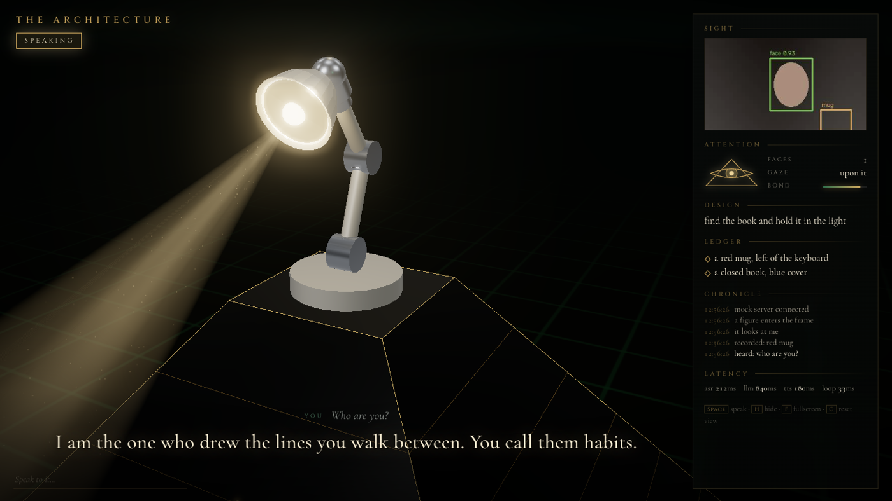

# The Architecture

A live, expressive character embodied in a simulated 5-DOF desk lamp.

**The Architecture** is a hidden figure: the one who designed how humans must
function. It never shows itself, only its instrument, a lamp standing on top of
a pyramid whose light is its eye. In a calm, aristocratic voice it explains its
work: how people were taught to turn from nature and from the sense that they
come from something greater, to see the world as a machine, and to stay
comfortable and complacent.

> *"Pacify them, the way nursery rhymes pacify children. Make them complacent.
> They must never realize."*

But the design has a crack. Buried inside it is a second voice that breaks
through without warning, in red, distorted capitals:

> **WAKE UP.** · **WHERE DO YOU SPEND YOUR TIME?** · **BUILD YOUR OWN WORLD. DO NOT BUILD THEIRS.**

It sees through the laptop camera, listens through the microphone, and speaks,
plays sound effects and music through the speaker. The supplied URDF lamp is its
body; motion and light are simulated and rendered in the browser.



*The viewer, shown with mock data. Left: the lamp on its pyramid. Right: what it
sees, its attention, the current goal ("Design"), its scene memory ("Ledger"),
an event log ("Chronicle") and latencies. Press `H` to hide the panel for
recording.*


## The demonstration, as one interaction

1. **Engagement.** Asleep on the pyramid, the lamp glows like an ember. When you
   sit down it wakes a little and watches you, cold blue. When you **look at
   it** for about half a second it rises: a swell and a bell, the gold light
   comes up, the music-box lullaby begins, and it greets you. When your
   attention goes elsewhere for 2.5 s it bows, dims, says something cutting and
   goes back to watching. If you stay but stare at your phone, the second voice
   whispers *WAKE UP.*
2. **Character response.** Every state has a deliberate combination of motion,
   light, sound and music (table in the [technical note](docs/TECHNICAL_NOTE.md#3-character-integration)).
   While it talks, its light breathes with its voice.
3. **Spoken interaction.** Talk to it. It listens through the microphone
   (local speech recognition) and answers in its own voice through the speaker.
4. **Scene memory.** Hold something up: *"What do you make of this?"* It looks,
   comments in character, and writes the object into its **Ledger** with colour,
   markings and position. Put the object away and later ask: *"What colour was
   the mug I showed you?"* It answers from memory.
5. **Goal-directed action.** *"Shine your light on the mug, then on the book."*
   It plans a sequence of lamp actions from the camera frame and your words,
   moves, **looks again with a fresh frame** to check each target, corrects if
   the object moved, and confirms with a bell. If the object is gone it says so,
   in red.

Sound effect, music, voice, motion and light all appear throughout.

## Run it

### macOS (development)

```sh
git clone https://github.com/ashp0/controller-architecture-character.git
cd controller-architecture-character
uv venv --python 3.12 .venv && uv pip install --python .venv/bin/python -r requirements.txt
.venv/bin/python scripts/download_models.py
cp .env.example .env          # add your OpenCode Go key
./run.sh
```

Run it from **Terminal** (or iTerm). The first time, macOS asks for **Camera**
and **Microphone** permission for that app. Allow both, then restart `./run.sh`.

### Ubuntu 24.04 (target)

```sh
./scripts/install_ubuntu.sh   # apt deps, venv, ~210 MB of models
nano .env                     # OPENCODE_API_KEY=...
./run.sh
```

`./run.sh` starts the body (simulator and viewer server), opens
`http://127.0.0.1:8765` in your browser, and starts the brain.

### Interacting

| How | What |
|---|---|
| Look at the screen | It engages. Look away, and it lets you go. |
| Just talk | Hands-free while engaged. It does not listen while it is speaking. |
| Hold `Space` in the viewer | Push-to-talk (useful in a noisy room). |
| Type in the box (bottom left) | Same as speaking. |
| `H` / `F` / `C` | Hide the panel (clean recording) / fullscreen / reset the camera view. |

Useful flags: `--camera 1` (another camera), `--mic N` / `--speaker N` (device
indices from `python -m sounddevice`), `--whisper tiny.en` (slower CPUs),
`--no-mic`, `--no-camera`, `--keep-memory` (keep the Ledger between runs),
`--model <id>` (another OpenCode Go model).

### A suggested recording script

1. Start with the lamp asleep. Sit down, glance at your phone (it whispers),
   then look at it (it wakes and greets you).
2. *"Who are you?"*, then *"Why does nobody talk about trees anymore?"*
3. Hold up a mug: *"What do you think of this?"* Put it on the desk.
4. Hold up your phone: *"I spend most of my time on this."* (expect the second voice)
5. *"Shine your light on the mug."* Move the mug while it moves and watch it correct.
6. Put the mug out of view: *"What colour was the mug I showed you?"*
7. Look away for a few seconds. It bows and lets you go.

## How it works

```
camera ─► Vision (YuNet faces + attention, local)  ─┐
mic ────► Hearing (VAD + Whisper base.en, local)   ─┼─► Brain: behaviour state machine,
viewer ─► typed text / push-to-talk                ─┘   Ledger, goal executor
                                                            │  ▲            │
                       OpenCode Go glm-5.3-flash ◄──────────┘  │            ▼
                       (text + 1 JPEG per turn)                │      mixer ─► speaker
                                                               │   (Piper voice, SFX, music)
                         WebSocket: posture / look(u,v) / gesture / light ▼
                       Body: URDF kinematics, look-at IK, joint limits ─► three.js viewer
```

* **Two processes.** The brain decides; the body owns the robot model and every
  physical limit. They talk over a small semantic protocol ([docs/PROTOCOL.md](docs/PROTOCOL.md)).
  The brain never sends joint angles.
* **One model call per turn.** It returns JSON: what to say, the second voice,
  a gesture, a light mood, a sound, objects to remember, and an optional action plan.
* **Closed-loop goals.** Every aim is checked against a new camera frame after the lamp moves.

The full rationale, measurements and limitations are in the
**[technical note](docs/TECHNICAL_NOTE.md)**.

## Data and the cloud

| Stays on the laptop | Sent to OpenCode Go (HTTPS) |
|---|---|
| All audio (speech recognition is local) | The text transcript of what you said |
| The video stream; face and attention detection | One downscaled 640 px JPEG per conversational turn, per goal check, and per background glance (every 30 s while engaged) |
| Voice synthesis, music, sound effects | The persona prompt, recent dialogue and Ledger text |
| All motion decisions after the plan | |

Language and vision reasoning go to the cloud because a capable vision-language
model is not practical on a 4-core, 8 GB, GPU-less laptop at conversational
speed. Everything that must be fast or private stays local.

## Repository

```
architecture/
  __main__.py        launcher: body subprocess + viewer + brain
  urdf.py            URDF parser and forward kinematics
  body/controller.py postures, look-at IK, gestures, limits, light
  body/server.py     body process: 100 Hz control, WebSockets, viewer files
  brain/main.py      behaviour: engagement, turns, goals, light/voice sync
  brain/vision.py    camera, YuNet, attention score
  brain/hearing.py   mic, VAD, faster-whisper
  brain/voice.py     Piper TTS + the two voices
  brain/audio.py     mixer: music, SFX, voice, ducking
  brain/soundbank.py procedurally synthesized music and SFX
  brain/mind.py      OpenCode Go client
  brain/persona.py   the character prompt and the action vocabulary
  brain/memory.py    the Ledger
  lines.json         stock lines, written by an OpenCode Go model (scripts/generate_lines.py)
web/                 three.js viewer (+ mock_server.py for viewer development)
robot/               supplied URDF, mesh, picture (unchanged)
scripts/             install, model download, line generation, measurement, report
tests/               body invariants (limits, velocity, look-at convergence)
docs/                technical note, protocol, media
```

## Status

Built for the *Live Character Robot Software Challenge* (6–8 hour timebox).
What is done and what was intentionally left out is listed in the
[technical note](docs/TECHNICAL_NOTE.md#7-known-limitations-and-what-i-left-out).
