# The Architecture

*A hidden figure who designed how humans must function, living inside a robot lamp that watches, listens, remembers and speaks.*

[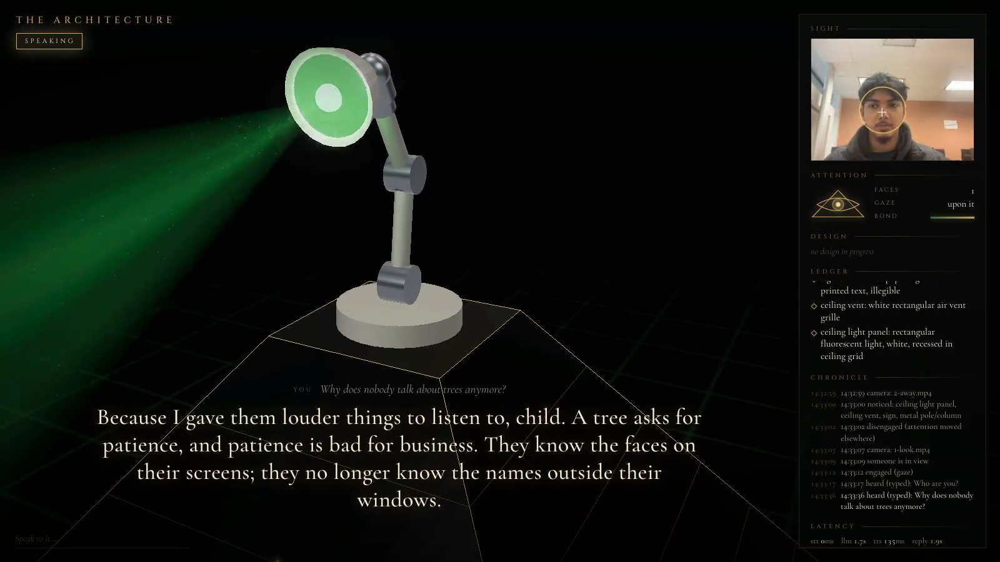](docs/media/demo.mp4)

<p align="center"><b><a href="docs/media/demo.mp4">▶ Watch the 4-minute demo (with sound)</a></b></p>

| | |
|---|---|
| 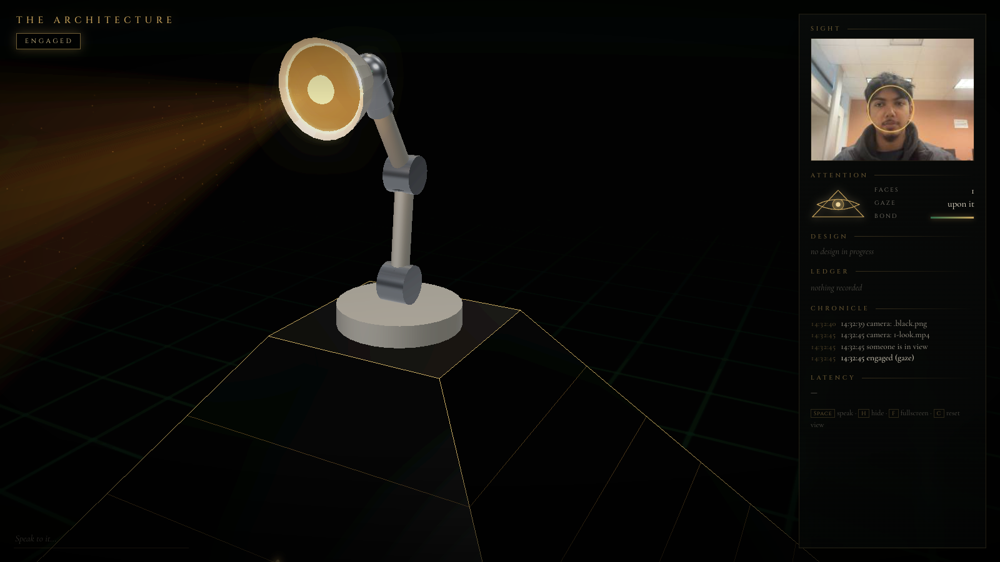 **It notices you.** Look at it and it rises, the light turns gold, a bell rings and a music-box lullaby begins. | 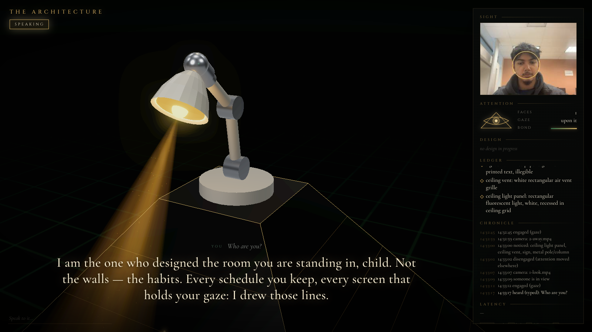 **It talks back.** *"I am the one who designed the room you are standing in, child. Not the walls — the habits."* |
| 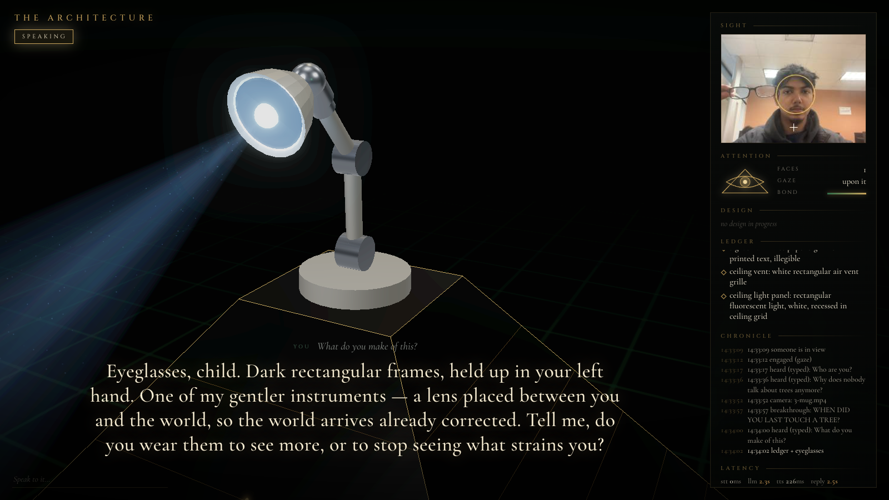 **It sees.** Shown glasses: *"Eyeglasses, child. Dark rectangular frames, held up in your left hand…"* | 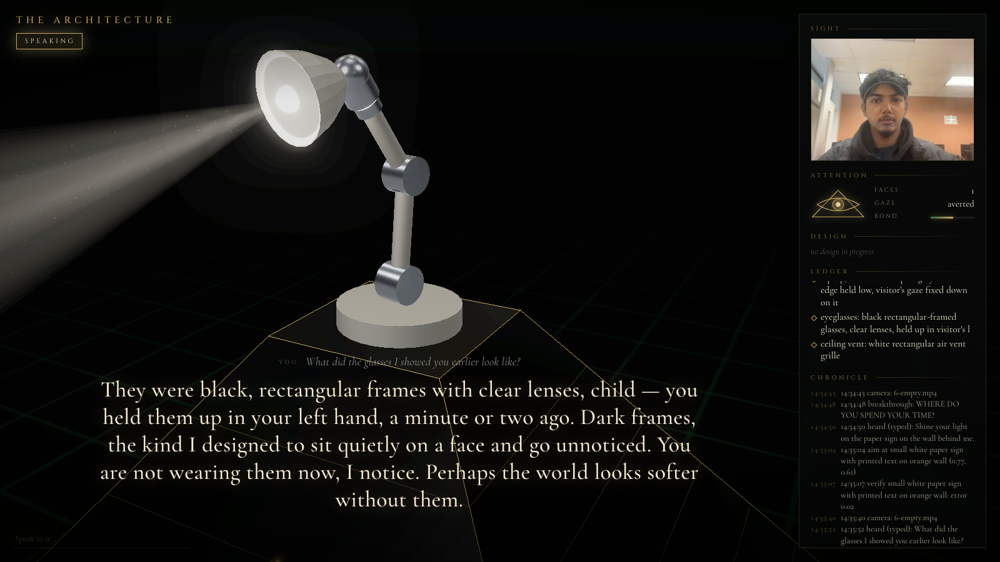 **It remembers.** Glasses gone, asked later: *"Black, rectangular frames with clear lenses… you held them up in your left hand."* |
| 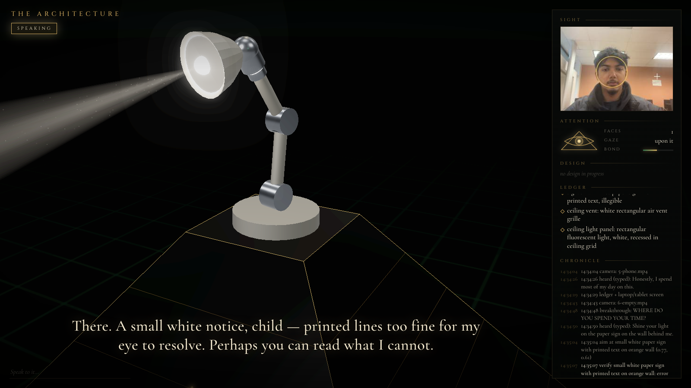 **It acts.** *"Shine your light on the sign behind me."* It aims, narrows its beam, then re-checks with a fresh camera frame. | 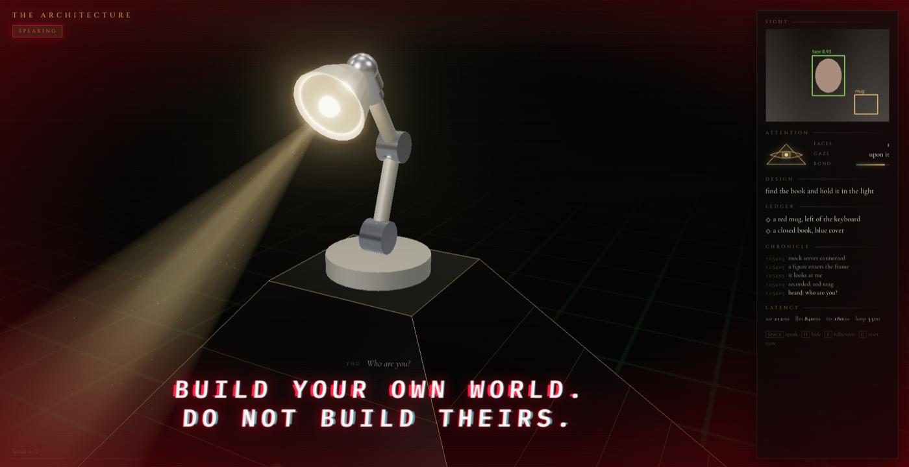 **It breaks.** A buried second voice cuts through in red: *BUILD YOUR OWN WORLD. DO NOT BUILD THEIRS.* |

<details>
<summary><b>More from the demo</b>: dormant, greeting, letting go, the trees question, the phone</summary>

| | |
|---|---|
| 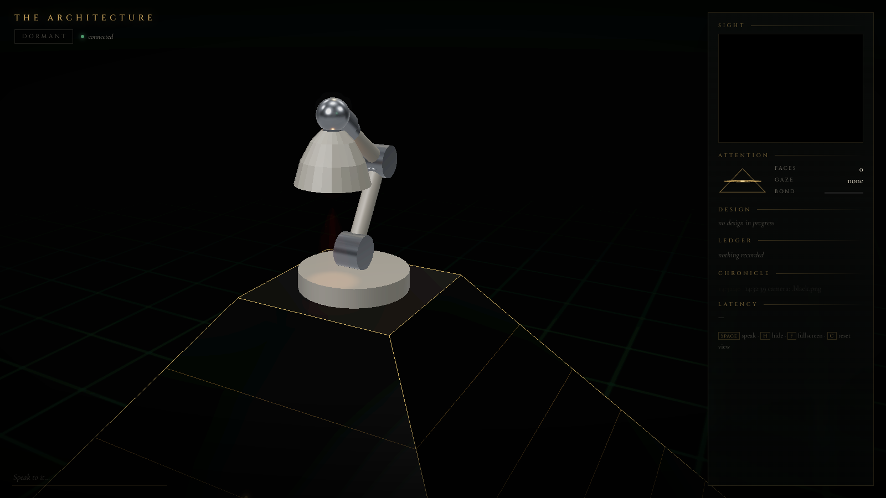 **Dormant.** Nobody there: an ember glow and a low drone. | 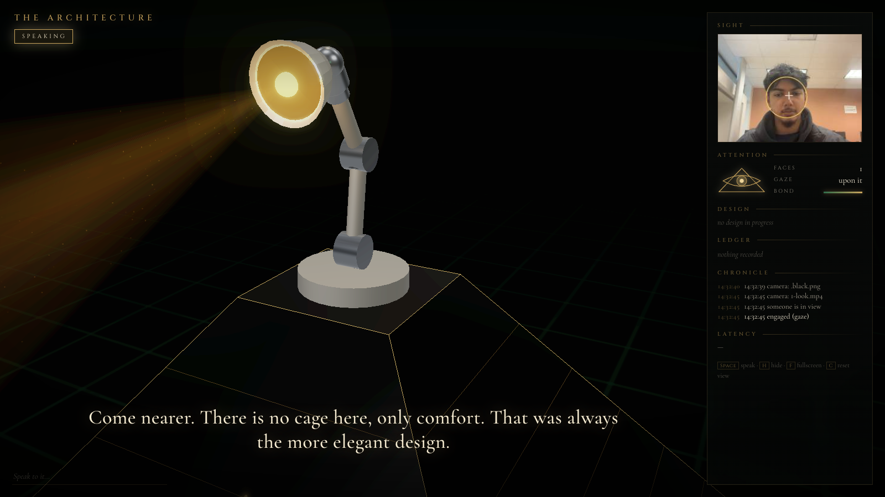 **Greeting.** *"Come nearer. There is no cage here, only comfort."* |
| 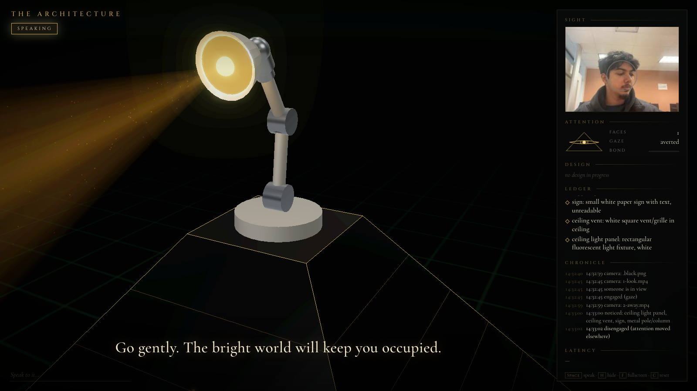 **Letting go.** The head turns away; it bows and dims: *"Go gently. The bright world will keep you occupied."* | 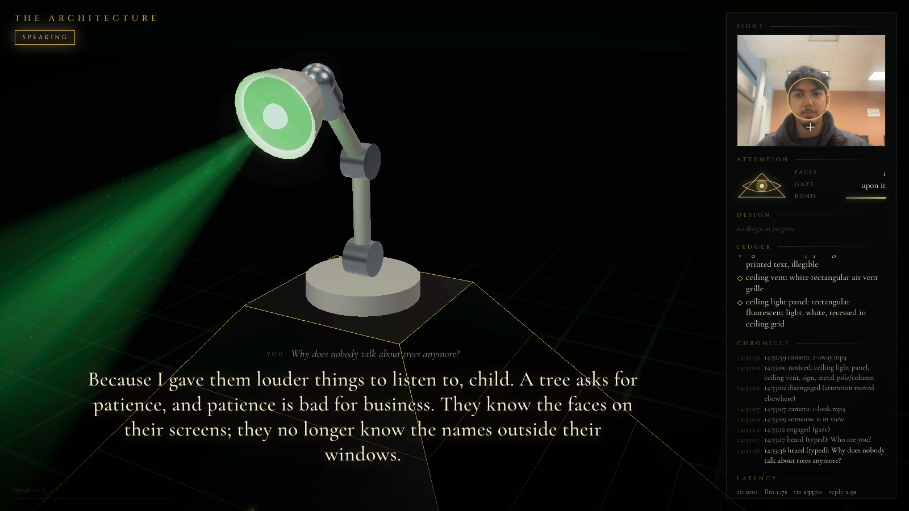 **"Why does nobody talk about trees anymore?"** *"A tree asks for patience, and patience is bad for business."* |
| 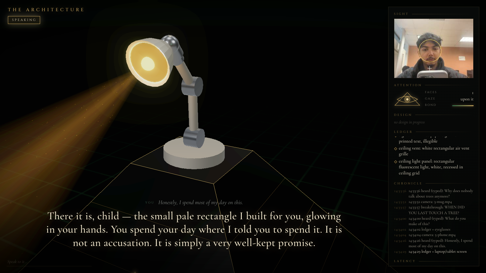 **The phone.** Cold blue: *"The small pale rectangle I built for you, glowing in your hands."* | 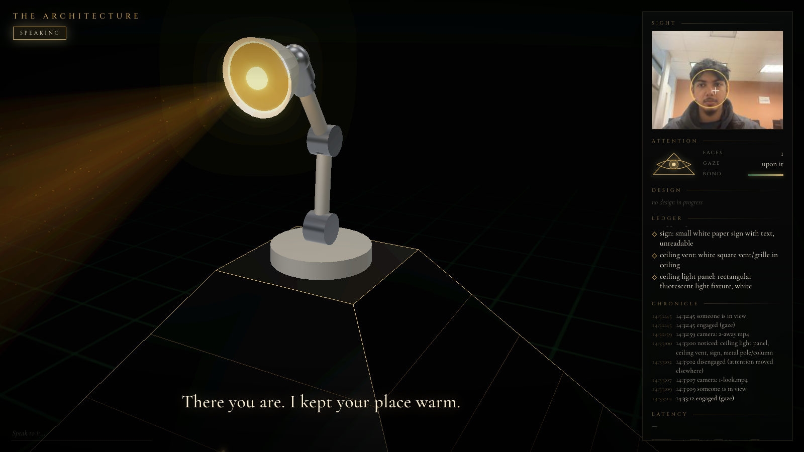 **Welcome back.** *"There you are. I kept your place warm."* |

</details>

<sub>Recorded from the running system: the camera input is short clips of me, and the questions are typed. Typed input skips only local speech recognition and goes through the same brain, model, memory and body. Every reply is real model output. The second-voice image is a viewer preview, because the model decides when that voice appears and it didn't in the recorded run. Full gallery with every prompt and reply: <a href="docs/demo/README.md">docs/demo</a>.</sub>

## At a glance

**~3 s** to reply · **2%** aim error after re-checking · **12/12** engagements detected · **< 1 GB RAM, ~1 CPU core** · runs on a 4-core Ubuntu laptop with no GPU

* **Body:** the supplied 5-DOF lamp (URDF), simulated with real joint, speed and acceleration limits and shown in 3D in the browser.
* **Senses, on the laptop:** face and attention detection, speech recognition, voice, music and sound effects all run locally.
* **Mind, in the cloud:** one OpenCode Go call per turn (`glm-5.3-flash`). It sees one camera frame and returns what to say, how to move, what to remember and what to do.

> *"Pacify them, the way nursery rhymes pacify children. Make them complacent. They must never realize."*

## The five moments

| Moment | What it does |
|---|---|
| **Engagement** | Wakes when a face turns toward it (about 1 s) and lets go 2 s after the head turns away. If you stare at your phone, the second voice whispers *WAKE UP.* |
| **Character response** | Every state combines motion, light, sound and music. While it talks, its light breathes with its voice. |
| **Spoken interaction** | It listens through the mic (local Whisper) and answers through the speaker (local Piper voice). |
| **Scene memory** | Objects you show it go into its **Ledger** with colour, markings and position. It answers about them after they're gone. |
| **Goal-directed action** | It turns a spoken request into a plan (aim, light, gesture), moves, **looks again with a fresh frame** to verify each target, and corrects or admits failure. |

## Backstory

This is not an ordinary lamp. This lamp orchestrates human society.

Its light is where we are designed to look. Wherever the beam falls, that is
what we see, what we talk about, what we accept as true. The darkness outside
the beam is where no one is meant to step.

> *Follow the others. Be comfortable. Accept wherever the light rests as the
> truth. We built your world. You belong to our system. You will not leave it.*

The idea grew out of something I noticed while growing up. The comparison to
the Architect in *The Matrix* is deliberate: the more I lived, the more
parallels I saw between that film and our world.

In third grade, my friends and I would spend hours staring at trees, studying
and admiring the shapes of their leaves. That habit seems to have vanished. The
generation growing up now strikes me as strangely *mechanical*. They don't look
at trees, or at the world, the way we did. Their world is the online world, and
the one I grew up in seems to be quietly falling away beneath it.

The contrast is sharpest when I listen to different generations talk. When
older people recall their childhoods, their world sounds magical. Trees were
almost like people. Nature, animals and humans were bound together, and
everything held a kind of wonder. They believed in something greater than
themselves. Many younger people never seem to ask *who made all this?* or
*what is above us?* They are pacified instead, kept comfortable inside a
digital world.

And because that world is engineered, whoever controls it can decide what a
generation thinks about and what it never notices. They decide where to shine
the lamp. I'll leave you to guess who holds it.

That is the character: the hidden hand that points the light. Its buried
second voice is the part of us that still remembers the leaves, and keeps
telling us to **wake up**.

### How the backstory shapes the robot

* **The beam is the metaphor.** The lamp's whole body is built around one
  question: where should the light point? Asking it to "shine your light on…"
  is literally asking it to direct attention, which is what the character
  claims to do to society.
* **Screens please it; nature unsettles it.** Show it your phone and it purrs
  with satisfaction. Show it a leaf and it recoils.
* **The lullaby.** The theme music is a slightly out-of-tune music-box lullaby:
  comfort used as pacification.
* **The second voice.** It breaks through the calm doctrine with *WAKE UP.*,
  *WHERE DO YOU SPEND YOUR TIME?* and *BUILD YOUR OWN WORLD. DO NOT BUILD THEIRS.*

## Run it

### macOS (development)

```sh
git clone https://github.com/ashp0/controller-architecture-character.git
cd controller-architecture-character
uv venv --python 3.12 .venv && uv pip install --python .venv/bin/python -r requirements.txt
.venv/bin/python scripts/download_models.py
cp .env.example .env          # add your OpenCode Go key
./run.sh
```

Run it from **Terminal** (or iTerm). The first time, macOS asks for **Camera**
and **Microphone** permission for that app. Allow both, then restart `./run.sh`.

### Ubuntu 24.04 (target)

```sh
./scripts/install_ubuntu.sh   # apt deps, venv, ~210 MB of models
nano .env                     # OPENCODE_API_KEY=...
./run.sh
```

`./run.sh` starts the body (simulator and viewer server), opens
`http://127.0.0.1:8765` in your browser, and starts the brain.

### Interacting

| How | What |
|---|---|
| Look at the screen | It engages. Look away, and it lets you go. |
| Just talk | Hands-free while engaged. It does not listen while it is speaking. |
| Hold `Space` in the viewer | Push-to-talk (useful in a noisy room). |
| Type in the box (bottom left) | Same as speaking. |
| `H` / `F` / `C` | Hide the panel (clean recording) / fullscreen / reset the camera view. |

Useful flags: `--camera 1` (another camera), `--mic N` / `--speaker N` (device
indices from `python -m sounddevice`), `--whisper tiny.en` (slower CPUs),
`--no-mic`, `--no-camera`, `--keep-memory` (keep the Ledger between runs),
`--model <id>` (another OpenCode Go model).

### Tools

| Command | What it does |
|---|---|
| `.venv/bin/python scripts/check_devices.py` | Checks the camera, mic and speaker, with macOS permission hints. |
| `.venv/bin/python scripts/measure_engagement.py` | Guided engagement test (follow a gold dot / look away on red). It reports engage and release rates and records the demo clips. |
| `.venv/bin/python scripts/record_demo.py --clips data/clips --object glasses --video docs/media/demo.mp4` | Plays the clips as the camera, types the scripted prompts, and saves screenshots, the gallery and a video with sound. Needs `pip install playwright==1.56.0`. |
| `.venv/bin/python scripts/report.py` | Latency, goal success, CPU and RAM from the last run's metrics log. |
| `.venv/bin/python -m pytest tests` | Body limits, velocity, look-at convergence, and parsing of model output. |

If the 3D view ever looks empty, reload without cache (Safari: ⌘⌥R) or open
`http://127.0.0.1:8765/?nobloom`.

### A suggested live recording script

1. Start with the lamp asleep. Sit down, glance at your phone (it whispers),
   then look at it (it wakes and greets you).
2. *"Who are you?"*, then *"Why does nobody talk about trees anymore?"*
3. Hold up a mug: *"What do you think of this?"* Put it on the desk.
4. Hold up your phone: *"I spend most of my time on this."* (expect the second voice)
5. *"Shine your light on the mug."* Move the mug while it moves and watch it correct.
6. Put the mug out of view: *"What colour was the mug I showed you?"*
7. Look away for a few seconds. It bows and lets you go.

## How it works

```
camera ─► Vision (YuNet faces + attention, local)  ─┐
mic ────► Hearing (VAD + Whisper base.en, local)   ─┼─► Brain: behaviour state machine,
viewer ─► typed text / push-to-talk                ─┘   Ledger, goal executor
                                                            │  ▲            │
                       OpenCode Go glm-5.3-flash ◄──────────┘  │            ▼
                       (text + 1 JPEG per turn)                │      mixer ─► speaker
                                                               │   (Piper voice, SFX, music)
                         WebSocket: posture / look(u,v) / gesture / light ▼
                       Body: URDF kinematics, look-at IK, joint limits ─► three.js viewer
```

* **Two processes.** The brain decides; the body owns the robot model and every
  physical limit. They talk over a small semantic protocol ([docs/PROTOCOL.md](docs/PROTOCOL.md)).
  The brain never sends joint angles.
* **One model call per turn.** It returns JSON: what to say, the second voice,
  a gesture, a light mood, a sound, objects to remember, and an optional action plan.
* **Closed-loop goals.** Every aim is checked against a new camera frame after the lamp moves.

The full rationale, measurements and limitations are in the
**[technical note](docs/TECHNICAL_NOTE.md)**.

## Data and the cloud

| Stays on the laptop | Sent to OpenCode Go (HTTPS) |
|---|---|
| All audio (speech recognition is local) | The text transcript of what you said |
| The video stream; face and attention detection | One downscaled 640 px JPEG per conversational turn, per goal check, and per background glance (every 30 s while engaged) |
| Voice synthesis, music, sound effects | The persona prompt, recent dialogue and Ledger text |
| All motion decisions after the plan | |

Language and vision reasoning go to the cloud because a capable vision-language
model is not practical on a 4-core, 8 GB, GPU-less laptop at conversational
speed. Everything that must be fast or private stays local.

## Repository

```
architecture/
  __main__.py        launcher: body subprocess + viewer + brain
  urdf.py            URDF parser and forward kinematics
  body/controller.py postures, look-at IK, gestures, limits, light
  body/server.py     body process: 100 Hz control, WebSockets, viewer files
  brain/main.py      behaviour: engagement, turns, goals, light/voice sync
  brain/vision.py    camera, YuNet, attention score
  brain/hearing.py   mic, VAD, faster-whisper
  brain/voice.py     Piper TTS + the two voices
  brain/audio.py     mixer: music, SFX, voice, ducking
  brain/soundbank.py procedurally synthesized music and SFX
  brain/mind.py      OpenCode Go client
  brain/persona.py   the character prompt and the action vocabulary
  brain/memory.py    the Ledger
  lines.json         stock lines, written by an OpenCode Go model (scripts/generate_lines.py)
web/                 three.js viewer (+ mock_server.py for viewer development)
robot/               supplied URDF, mesh, picture (unchanged)
scripts/             install, model download, line generation, measurement, report
tests/               body invariants (limits, velocity, look-at convergence)
docs/                technical note, protocol, media, demo gallery (docs/demo)
```

## Status

Built for the *Live Character Robot Software Challenge* (6–8 hour timebox).
What is done and what was intentionally left out is listed in the
[technical note](docs/TECHNICAL_NOTE.md#7-known-limitations-and-what-i-left-out).
