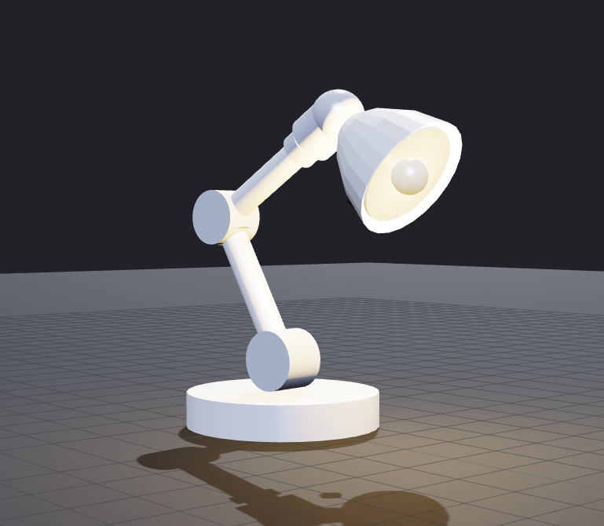

# Lamp: a live character robot

A live, expressive character built around a fictional 5-DOF desk-lamp robot.
The laptop camera is its eyes, the microphone its ears, and the speaker its
voice, music and sound effects. A simulated body, driven from the supplied URDF,
provides motion and light.

> **Status: work in progress.** This repository is being built for the
> *Live Character Robot Software Challenge* (6–8 hour timebox). This README
> will be replaced by setup instructions and a technical note as the work lands.



## Goal

One continuous interaction in which the lamp feels like one aware character,
not a set of separate AI demos:

1. **Engagement.** It notices when someone looks at it, and lets go when their
   attention moves elsewhere.
2. **Character response.** It greets the person with a deliberate mix of
   motion, light, voice, sound effects and music.
3. **Spoken interaction.** It listens through the microphone and answers
   through the speaker.
4. **Scene memory.** It sees an object, remembers useful facts about it, and
   answers a spoken question about it later.
5. **Goal-directed action.** Given a spoken goal about the live scene, it uses
   vision and language to choose a sequence of lamp actions, then looks again
   before it calls the goal done.

## The robot

`robot/dummy_lamp_5dof.urdf` (supplied) defines five revolute joints:

| Joint | Axis | Range (rad) | Max velocity (rad/s) |
|---|---|---|---|
| `base_yaw_joint` | z | −2.60 … 2.60 | 1.50 |
| `shoulder_pitch_joint` | y | −0.75 … 1.05 | 0.95 |
| `elbow_pitch_joint` | y | −1.85 … 0.40 | 1.15 |
| `neck_yaw_joint` | z | −1.35 … 1.35 | 1.60 |
| `head_pitch_joint` | y | −0.90 … 0.70 | 1.45 |

Fixed frames carry the light emitter and camera in the lamp head, and the
speaker in the base. Every motion command will respect these limits, as it
would have to on real hardware.

## Target environment

Clean Ubuntu 24.04 LTS laptop: 4 CPU cores, 8 GB RAM, no GPU, built-in camera,
microphone and speaker through standard Linux audio, Wi-Fi.

## Cloud use

Language and vision reasoning go through an
[OpenCode Go](https://opencode.ai) subscription (OpenAI-compatible API).
Exactly what data leaves the laptop, and what is decided locally, will be
documented here as each piece is built. Configure it with:

```sh
cp .env.example .env   # then add your OPENCODE_API_KEY
```

## Repository layout

```
robot/            Supplied URDF, mesh and reference image (unchanged)
```

More to come.
