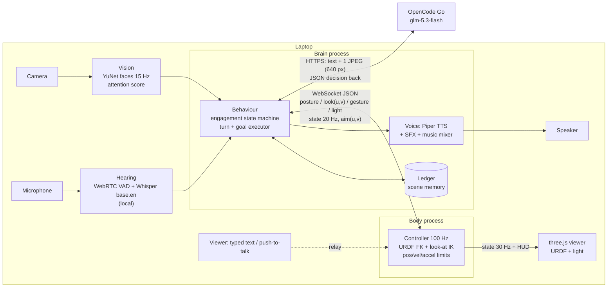

# The Architecture: technical note

*A live character on a simulated 5-DOF lamp. Two pages: architecture, decisions, measurements, limits.*

## 1. Architecture and data flow

**Two processes, one boundary.** The **brain** perceives, remembers and decides.
The **body** owns the robot model and every physical constraint. They speak the
semantic protocol in [PROTOCOL.md](PROTOCOL.md): *look at image point (u, v)*,
*gesture nod*, *light red, narrow*. Joint angles never cross the boundary
inbound. Swapping the simulator for a hardware driver means reimplementing one
small process. If the brain crashes, the body goes safely to sleep.

## 2. Model-to-action

Each spoken turn makes **one** model call. The input is the persona, the Ledger as
text, the recent dialogue and one camera frame. The output is a JSON decision:
`say`, `breakthrough`, `gesture`, `light`, `sfx`, `remember[]`, `plan[]`,
`done_line`, `farewell`. The brain validates each field against a closed
vocabulary (unknown gestures or lights are dropped), and only then does the body
act.

**Goal-directed action (VLA by composition).** For a request like *"shine your
light on the red block, then the blue one"*, the model returns a plan of
primitives: `aim(target, box)`, `light(name, beam)`, `gesture(name)`, `wait(s)`.
Each `aim` runs as a closed loop:

1. Convert the box centre to `look(u, v)`.
2. The body solves IK and moves within its limits, then reports `settled`.
3. Take a **fresh** frame captured after the motion.
4. Re-locate the target with the vision model.
5. Compare its centre with the body's reported `aim(u, v)`.
6. If the error is under 0.09 of the image width, the step is done. Otherwise re-aim (up to 3 tries). If the object is gone, fail honestly: red light, a head shake, a spoken line.

The model decides *what* and *where*. The body decides *how*, and stays safe.

**Camera model.** The laptop camera is treated as the lamp's eye: a pinhole
camera (62° HFOV) placed at the lamp, looking at the visitor. An image point maps
to a 3D point 1.1 m away; the IK points the light emitter's +x axis at it.
The same model projects the light axis back into the image, which gives the
`aim` measurement. This is a calibration assumption, not a measurement. See the
limitations.

## 3. Character integration

| Moment | Motion | Light | Sound |
|---|---|---|---|
| Nobody there | `sleep` posture, slow breathing | ember 7%, slow pulse | low drone |
| Face, not looking | `idle`, lazily tracks the face | cold blue, 25% | drone; after 12 s the second voice whispers *WAKE UP.* |
| Looks (≥0.4 s) | `awaken` gesture, rises to `attentive`, tracks the face | gold fades up | rising swell + bell → music-box lullaby theme → spoken greeting |
| Listening | tracks the face | gold, 0.4 Hz pulse | music ducked |
| Thinking | `ponder` tilt | green, 1.4 Hz pulse | clockwork ticks |
| Speaking | gesture chosen by the model | intensity follows the voice envelope, colour = mood | voice; music ducked to 35% |
| Breakthrough | `recoil` | hard red flash | glitch + distorted, doubled voice |
| Goal | IK aim per step, `focus` on success | narrow white spotlight | resolved bell on completion |
| Looks away (>2.5 s) | `bow` | dims | falling tone, farewell line, drone returns |

All music and sound effects are synthesized from code (`soundbank.py`). The
music is an original, deliberately out-of-tune music-box lullaby over a drone,
which is the character's doctrine of pacification in musical form.

## 4. Key design choices and tradeoffs

* **Cloud only for reasoning; perception of people stays local.** Face and
  attention detection, VAD, speech recognition and TTS all run on CPU. These are
  the latency-critical and privacy-sensitive paths, and they keep working
  offline. The model sees **one 640 px JPEG per turn or goal step**, plus text.
  It never receives audio or a video stream. A 2.5–4 s round trip is acceptable
  for deliberate turns, and it is masked by thinking motion, light and sound,
  plus a filler line after 3.5 s.
* **`glm-5.3-flash` with reasoning disabled.** In a bake-off of six OpenCode Go
  vision models it gave the fastest accurate bounding boxes (≈2.5 s), and it is
  among the cheapest ($0.15 / $0.50 per M tokens). Reasoning on took 7 s;
  reasoning off took 1–2 s for text.
* **Attention from landmarks, not a gaze model.** YuNet's five landmarks give a
  head-yaw proxy (nose offset between the eyes) at ~3 ms per frame. A 0.4 s
  smoothing constant and hysteresis (engage above 0.6; release after 2.5 s below
  0.2) mean a glance does not engage and a blink does not release.
* **Ledger as structured text, not embeddings.** Tens of objects fit in the
  prompt, recall is exact, and the memory is human-readable (it is shown live in
  the viewer). Objects enter from turns (`remember`) and from silent background
  glances every 30 s while engaged.
* **Simulation as a kinematic controller plus a browser viewer** rather than a
  physics engine. Character motion needs limits, velocity and acceleration
  realism, not contact dynamics. That costs ~5% of one core instead of a GPU.
* **Half-duplex audio.** The microphone is muted while the lamp speaks (plus a
  0.35 s tail), so laptop speakers cannot trigger it. Barge-in is not supported.

## 5. Deployment (Ubuntu 24.04, 4 cores, 8 GB, no GPU)

`scripts/install_ubuntu.sh` installs `python3-venv`, `libportaudio2` and
`libsndfile1` via apt, creates a venv from `requirements.txt` (CPU-only wheels:
onnxruntime, ctranslate2, OpenCV) and downloads ~210 MB of models. `./run.sh`
starts the body, opens the viewer and runs the brain. Audio goes through
PortAudio → ALSA → PipeWire; the camera goes through V4L2. Whisper uses
2 threads with int8; `--whisper tiny.en` is available on slower CPUs. The only
network dependency is HTTPS to OpenCode Go. Without it, the lamp still engages,
tracks and greets (stock lines), but cannot converse.

## 6. Measurements

Development machine: Apple M1 Pro, macOS. Numbers on the 4-core Ubuntu target
will be higher for Whisper and Piper (estimated ×2–3); the network-bound LLM
time should not change.

Scripted session: 8 conversational turns and 3 goals (5 aims), with a still
test image standing in for the camera and typed input (`logs/` →
`scripts/report.py`).

| Metric | p50 | p90 | Notes |
|---|---:|---:|---|
| Speech recognition (Whisper base.en int8, 3 s utterance) | 0.35 s | 0.37 s | local; 2 threads |
| Model decision (glm-5.3-flash, text + 640 px JPEG) | 3.3 s | 3.6 s | network-bound |
| TTS to first audio (Piper, per sentence) | 73 ms | 110 ms | local |
| End of speech → first reply audio (typed turns) | 3.4 s | ~4 s | add STT for spoken turns; a filler line covers waits over 3.5 s |
| Goal aim: final error, fraction of image width | 0.018 | 0.033 | all 5 aims verified on the 1st attempt |
| Goal step time (move + settle + re-observe) | 2.4 s | 2.7 s | 3/3 goals completed |
| Face/attention detection (YuNet, 320 px) | 3 ms/frame | | run at 15 Hz |
| Body control loop | 0.8 ms IK/tick | | 100 Hz |

| Process | CPU (% of one core), mean / p90 | RSS, mean / max |
|---|---|---|
| brain (vision, VAD, Whisper, Piper, mixer) | 34 / 48 | 348 / 590 MB |
| body (controller + WebSockets) | 10 / 17 | 28 / 48 MB |
| browser viewer | not measured (GPU/WebGL dependent) | |

Together that is under 1 GB and about one core: comfortable headroom on the
4-core, 8 GB target.

**Engagement reliability** needs a live person in front of a camera, so it is
measured by a guided protocol rather than claimed: `scripts/measure_engagement.py
--trials 10`. It alternates LOOK / LOOK AWAY phases and reports engage and
release rates, median reaction times and spurious flips with the production
thresholds. On static test images the detector correctly separated frontal
faces (head-yaw proxy −0.13) from a turned head (0.28 → not looking).
*Live results: to be added from the run on the demo laptop.*

## 7. Known limitations and what I left out

* **Camera ≠ lamp head.** The real camera is fixed in the laptop, while the
  simulated head moves. Aim is computed through an assumed camera model (fixed
  1.1 m depth, 62° FOV), so the verify step checks image-space alignment, not
  metric 3D pointing. A head-mounted camera would close this loop properly.
* **No barge-in**, and only one visitor is tracked (the largest face).
* **Attention uses head pose, not eye gaze**, so looking at the screen with your
  head turned reads as "not looking".
* **Cloud dependency for conversation and goals**, with 2–4 s latency. No
  streaming of LLM tokens into TTS (left out for time).
* **No physics simulation** (contacts, gravity loading, motor torque); joint
  effort limits in the URDF are not modelled.
* **No safety layer for real hardware** beyond limits (for example a current
  sensing stop). The protocol's semantic boundary is where it would go.
